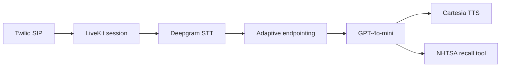

# Inclusive Voice Agent

[](https://github.com/RishbhaJain/inclusive-voice-agent/actions/workflows/ci.yml)

A real-time dealership voice agent that adapts turn-taking to the caller's
speaking rhythm, avoids interrupting syntactically incomplete utterances, and
grounds vehicle-recall answers in live NHTSA data.

## Results

| Evaluation | Cases | Result |
|---|---:|---:|
| Turn-taking decisions | 130 | **130 passed (100%)** |
| Neutral English | 92 | **100%** |
| Southern English scenarios | 23 | **100%** |
| San Diego conversational scenarios | 15 | **100%** |
| NHTSA context unit tests | 16 | **16 passed** |

The turn-taking suite covers complete requests, incomplete clauses, short
silences, hard timeouts, multi-sentence turns, conversational ellipsis, and
dialect-specific timing profiles. CI runs the evaluation offline and fails on
any incorrect decision. NHTSA tests use mocked HTTP responses and cover partial
provider failures, result limits, urgency classification, and safe formatting.

## Architecture



- **Speech pipeline:** LiveKit coordinates bidirectional audio, Deepgram
  transcription, Silero voice activity detection, OpenAI generation, and
  streaming Cartesia speech.
- **Interruption control:** spaCy checks whether the latest utterance is
  syntactically complete before the agent takes the turn.
- **Caller adaptation:** a bounded exponential moving average of speaking rate
  adjusts minimum and maximum endpointing delays without unbounded drift.
- **Grounded answers:** recall and complaint questions use live NHTSA results;
  provider failures degrade safely instead of inviting model speculation.

## What I built

- the LiveKit/Twilio worker and real-time speech pipeline
- adaptive endpointing driven by caller speaking rate
- syntactic turn-completion logic and the 130-case regression evaluation
- NHTSA recall/complaint grounding with failure handling and mocked tests
- Render and Railway deployment paths plus credential-free CI

## Run the offline evaluation

```bash
python3 -m venv .venv
source .venv/bin/activate
python -m pip install -r requirements-dev.txt
python -m spacy download en_core_web_sm

PYTHONPATH=. python Tests/eval.py
python -m pytest -q Tests/test_vehicle_context.py
```

No provider credentials or external API calls are required for these checks.

## Run the voice worker

```bash
python -m pip install -r requirements.txt
python -m spacy download en_core_web_sm
cp .env.example .env
python -m voicebot.lk_agent dev
```

Configure these environment variables:

```dotenv
LIVEKIT_URL=wss://your-project.livekit.cloud
LIVEKIT_API_KEY=your-livekit-key
LIVEKIT_API_SECRET=your-livekit-secret
DEEPGRAM_API_KEY=your-deepgram-key
OPENAI_API_KEY=your-openai-key
CARTESIA_API_KEY=your-cartesia-key
```

See [`docs/livekit_setup.md`](docs/livekit_setup.md) for the Twilio SIP and
LiveKit setup. `render.yaml` and `railway.toml` provide worker deployment
configuration.

## Repository map

| Path | Purpose |
|---|---|
| `voicebot/lk_agent.py` | LiveKit worker and speech-provider orchestration |
| `voicebot/turn_detector.py` | Syntactic turn-completion policy |
| `voicebot/call_adapter.py` | Bounded speaking-rate adaptation |
| `voicebot/vehicle_context.py` | NHTSA retrieval and grounded formatting |
| `Tests/eval.py` | 130-case turn-taking regression suite |
| `Tests/test_vehicle_context.py` | Mocked NHTSA unit tests |

## Current limitations

- The 130 cases are a deterministic text-and-silence benchmark, not a substitute
  for testing with diverse real callers and acoustic conditions.
- Dialect labels describe evaluation scenarios, not speaker identity inference.
- End-to-end latency depends on telephony, transcription, model, and TTS provider
  conditions and is not claimed by the offline benchmark.
